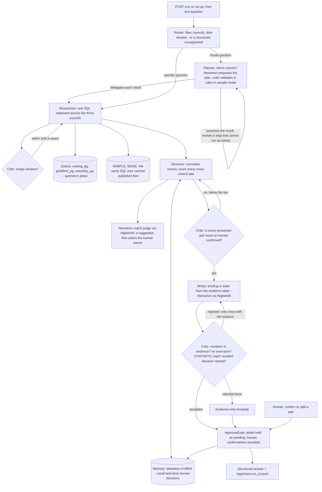

# VESTING DAY

> **Track:** Solving Fragmented Intelligence (Open Agent Hackathon 2026, Track 1). Solo entry.
> **Sponsor technology:** Zetaris (data layer), Meterless H-MEM engine (memory), Meterless Nightshift (primary AI provider), NVIDIA Nemotron.
> **Run:** `uv sync` then `uv run python run.py`, then open `http://localhost:8000` (or `POST /run`). No credentials needed.

## What a finance lead gets today

From the three councils' own published files, in one run of about 30 seconds live:

| Result | What happens next | The full list |
|---|---|---|
| **GBP 22.7m** in **173 contracts** that end within 180 days of vesting day with no extension date recorded past it; 45 of their suppliers are also paid by another of the councils | Decide novation, extension or planned expiry for each, largest first. The letter for the largest (GBP 8.5m, Guildford, ends 13 days after vesting day) is drafted and held for a person; nothing is sent | [`hard-cliff-contracts-ending-within-180.csv`](logs/exports/example-04/hard-cliff-contracts-ending-within-180.csv) |
| **228 supplier pairs** shared across the councils (identical names after normalisation), **GBP 34.8m** combined spend | One contract instead of two or three, biggest spend first. 217 similar names wait for a person to decide; each decision is remembered and changes the next answer | [`shared-suppliers-presented.csv`](logs/exports/example-01/shared-suppliers-presented.csv), [`candidates-needing-a-human-decision-match.csv`](logs/exports/example-01/candidates-needing-a-human-decision-match.csv) |
| **4 of 9** Council Tax Support clauses differ between Woking and Guildford; **4 of 8 SYNTHETIC** test residents would get a different answer on day one | Agree one scheme before vesting day. The options note is drafted and held for a person | [`day-one-check-synthetic-residents.csv`](logs/exports/example-05/day-one-check-synthetic-residents.csv) |
| In the six recorded live runs Nemotron wrote **11 drafts**; the Critic sent **3** back before anyone saw them: twice for calling pairs "confirmed as shared" when no person had confirmed them, and once for a brief that did not name the remembered human decision (mem-1) that had changed its answer | Every answer that reaches a person passed the Critic, or is the evidence-only template, badged as such | `logs/trace-live-01.jsonl`, `logs/trace-live-03.jsonl`, `logs/trace-live-06.jsonl` |

The same day-one results from one real live run (Nemotron chose the plan through Nightshift, every
query went through Zetaris): `logs/response-live-06.json`, with its full lists in `logs/exports/live-06/`.

Every number is computed at run time from the councils' published files and every row carries
its council, file and row. Every run writes its full action lists as CSV in `logs/exports/<run_id>/`,
and the web page offers each one as a download.

## The problem

An agent for England's merging councils. On 1 April 2027 Woking, Guildford and Waverley
(with the rest of West Surrey) become one new unitary authority. Their data does not: each
council publishes its spend on its own cadence and schema, keeps its own contracts register,
and runs its own Council Tax Support scheme. VESTING DAY queries that fragmented data in
place, resolves which suppliers the councils share, remembers every human decision so later
answers change, finds the contracts that fall off a cliff around vesting day and the policy
gaps residents hit on day one, and drafts the first actions - under a human approval gate.

**Who it is for:** the finance lead of the West Surrey shadow authority, now, before vesting
day. The migration of every system into one takes years; the merger's questions cannot wait.

**Why this track:** the three councils are three separately published, separately shaped
sources with different cadences. Zetaris federates them in place - one SQL statement across
three databases that are never merged - and every number in an answer names the council,
file and row it came from.

## What it does (real data, real numbers)

| Ask it | It answers with |
|---|---|
| Which suppliers do Woking, Guildford and Waverley share? | 228 supplier pairs shared (identical names after normalisation) across the councils' newest published windows, GBP 34.8m combined; 217 similar-name pairs awaiting a human decision. The match judge model only orders that queue; it never confirms a pair. Every row carries a provenance id |
| Confirm that 'A' (Waverley) is the same supplier as 'B' (Guildford) | A human decision stored in Meterless H-MEM as `mem-1`. The next overlap answer is resolved "using decision mem-1" - the memory changes a later answer |
| Which contracts end within six months of vesting day? (any window: "within a year", "three months", "90 days") | 173 contracts worth GBP 22.7m with no extension date recorded past 1 April 2027 (29 more have a recorded extension; 45 of the cliff suppliers are also paid by another council). The largest, GBP 8.5m at Guildford, ends 13 days after vesting day. One novation letter drafted and held for approval |
| What are the biggest risks on vesting day? (any broad question) | The Planner decides which checks the question needs - in live mode NVIDIA Nemotron proposes the plan and the code validates it - delegates them to the specialist agents, assesses each result, revises steps that cannot run as asked, and returns one prioritised day-one brief with every action held for approval |
| Where do the Council Tax Support schemes differ? | 4 of 9 clauses differ (capital limit GBP 10,000 vs 6,000; minimum award GBP 5 vs 10; backdating 6 months vs 1 month; Guildford excludes bands F-H), each citing a page of the published scheme. 4 of 8 SYNTHETIC test residents would be treated differently on day one |

Per-council spend in each newest window: Woking 9,718 payments / GBP 64,974,729.21;
Guildford 6,883 / GBP 48,624,787.75; Waverley 3,246 / GBP 28,275,155.15.

Everything above comes from the councils' own published files, downloaded 25 Oct 2026
(`data/raw/MANIFEST.md` has every URL and hash). Nothing is hardcoded: the numbers are
computed at run time from the data, and change when the data or a human decision changes.
Ask your own question - the Router reads the flow, the councils and the time window from it.

## Run it in two minutes (no credentials, no services, no network)

```bash
git clone https://github.com/NakuSurrey/vesting-day
cd vesting-day
uv sync                          # Python 3.12; https://docs.astral.sh/uv/
uv run python run.py             # serves the web page, POST /run and GET /health on 0.0.0.0:8000
```

Then open **http://localhost:8000**. The page lets you ask your own question or click an example,
run a three-step demo of memory changing the answer, confirm or split a supplier pair, approve a
held draft, and see every agent step from the run's trace beside the answer - with the steps the
Critic sent back highlighted. Every table has a "Download all rows (CSV)" link. The page opens
with the results of the newest recorded live run and a list of every live run committed in
`logs/`, each of which can be replayed step by step (read from the log, nothing re-run, action
buttons off). It is a thin layer over `POST /run`; nothing on it is pre-written.

Without uv: `python -m venv .venv`, activate it, `pip install -r requirements.txt`, then
`python run.py`. With Docker: `docker build -t vesting-day . && docker run --rm -p 8000:8000 vesting-day`
(CI builds the image and runs it with `--network none`).

With no `.env`, or with `cp .env.example .env` (it ships `SAMPLE_MODE=true`), the app runs in
SAMPLE_MODE: the same agents and the same logic over the cached published data, with a
deterministic template in place of the model (badged `sample-mode/template`). Placeholder
keys never switch on live mode. Then, in another terminal:

```bash
curl -s -X POST localhost:8000/run -H 'Content-Type: application/json' \
  -d @input_examples/01_supplier_overlap.json | python -m json.tool | head -40

curl -s -X POST localhost:8000/run -H 'Content-Type: application/json' \
  -d '{"run_id": "my-1", "input": {"query": "Which Guildford contracts end within a year of vesting day?"}}'
```

Or without the server:

```bash
uv run python run.py --input input_examples/01_supplier_overlap.json
uv run python run.py --query "Which companies are paid by all three councils?"
uv run python run.py --query "What are the biggest risks on vesting day?"      # the Planner chooses and runs the checks
```

Run the examples in sequence to watch memory change the answer:

```bash
uv run python run.py --reset-memory --input input_examples/01_supplier_overlap.json   # Unit4 pair: awaiting a human
uv run python run.py --input input_examples/02_confirm_match.json                      # a human confirms -> mem-1
uv run python run.py --input input_examples/03_supplier_overlap_after_decision.json    # pair shared, "resolved using decision mem-1"
```

Each run writes `logs/trace-<run_id>.jsonl` - one line per agent action: who acted, what it
received and produced, which agent it handed to, the model and receipt, the retry count and
the status - and echoes the same lines to the terminal. The response is one JSON object
(`run_id`, `status`, `output`, `agents`, `trace_id`, `log_file`,
`execution_time_seconds`); `--out FILE` also writes it as UTF-8. Seven example inputs are in
`input_examples/` with their real outputs in `output_examples/`.

## How it works

Eight agents, each a distinct code path in `app/agents/`. It is not a chain: the Planner decides
which checks a broad question needs and revises its plan, the Critic sends work back, the Resolver
relabels, the Researcher widens an empty query on request, the Writer retries with the Critic's
reasons, Memory changes what the Resolver concludes, and nothing leaves without the ApprovalGate.



- **Router** classifies free text into a flow (a broad question for the Planner, supplier overlap,
  confirm a match, contract cliff, policy gap, approve a draft), reads the councils and the time
  window ("within a year", "three months", "90 days"), or returns a structured
  `UnsupportedRequest` that lists what it can answer.
- **Planner** takes a broad question ("What are the biggest risks on vesting day?") and decides
  which checks it needs. In live mode NVIDIA Nemotron proposes the plan as JSON and the code
  validates it against the checks that exist - unknown steps are dropped, an unusable plan is
  replaced by the rule-based one and the trace says so. It delegates each check to the specialist
  agents, assesses what came back, revises a step that cannot run as asked (one council named for
  a two-council check), skips a step that fails and names it in the brief, then hands the Writer
  one evidence table for a prioritised day-one brief.
- **Researcher** runs SQL against the data layer. Live: Zetaris REST, query-in-place over the
  three councils' registered sources. Sample: the same SQL over SQLite loaded from the cached
  files. The agent code is identical; only the adapter differs, and a test proves live rows
  equal sample rows. When a contract window comes back empty the Critic asks it to widen the
  window (doubling, up to a year); the window the question asked for stays the headline.
- **Resolver** normalises supplier names, scores every cross-council pair (exact 0.95;
  fuzzy >= 0.92; 0.70-0.92 is the judge band), applies the decisions Memory recalled, asks
  Companies House when a key is present, and in live mode asks Nemotron for a suggestion on
  the band. The suggestion orders the human queue; it never changes a pair's status.
- **Memory** is the Meterless H-MEM engine (`app/engines/hmem`): human decisions are stored as
  long-term memories with provenance and recalled through the engine's ranked retrieval;
  every read and write lands in its append-only ledger (`data/memory/ledger.jsonl`).
- **Critic** checks every other agent and sends failing work back: pairs below the
  confirmation bar return to the Resolver; a draft returns to the Writer with the exact
  reasons when it uses a number not in the evidence, calls a pair confirmed or verified
  without a human decision, drops the SYNTHETIC label, or fails to name a remembered human
  decision it relied on. In a day-one brief it also rejects contracts said to end "on vesting
  day" (they end within the window) and a number placed under the wrong check. A draft
  rejected twice is replaced by the evidence-only template.
- **Writer** drafts briefings and letters from the evidence table only. Live: NVIDIA Nemotron
  (`nvidia/nemotron-3.5-lightning-30b-a3b`) through Meterless Nightshift, with the signed
  compute receipt id kept. Sample: a deterministic template.
- **ApprovalGate** holds every draft as `pending` and records human confirmations. Nothing is
  ever sent; approval records intent only.

Every displayed number carries a provenance id (`council:file:row`) back to the published
file; every generated text carries its model badge; synthetic data (the eight test residents
in `data/sample/residents_synthetic.csv`) is labelled SYNTHETIC wherever it appears.

## Why this is an agent system, not a pipeline

What makes this more than a fixed chain of calls, and where to see it. Each behaviour is a line
in `logs/trace-<run_id>.jsonl`:

| Behaviour | Where it happens | Trace line to look for |
|---|---|---|
| The model decides which steps to take | Planner, live mode | `Planner plan` with `model: nvidia/nemotron-3.5-lightning-30b-a3b`, a `receipt_id` and `source: model` |
| Dynamic delegation | Planner -> specialist agents | `Planner delegate -> Researcher`, one per chosen check; a question about suppliers alone gets one step, a broad one gets three |
| Plan revision | Planner | `Planner revise_plan` (`needs_revision`): one council named for a two-council check, or Waverley named for the clause table |
| Critique loop | Critic -> Resolver, Critic -> Writer | `Critic critique_matches rejected ... returning to Resolver`; `Critic critique_draft rejected ... returning to Writer` with the exact reason |
| Retry that changes the work | Resolver, Writer, Researcher | `Resolver relabel` (`retry_count: 1`); `Writer draft` with `retry_count: 1` carrying the Critic's reasons; `Researcher query_data_layer` with `retry_count` after `Critic critique_coverage` widened an empty window |
| Role authority | Critic, ApprovalGate | a draft rejected twice is replaced by the evidence-only template (`Writer draft fallback`); every drafted action is `hold_for_approval ... pending; nothing sent` |
| Shared memory that changes an answer | Memory -> Resolver -> Writer | `Memory recall ... resolved from memory: mem-1`, and the Critic will not pass a briefing that leaves that decision unnamed |
| Escalation | Critic, Planner, Writer | similar names go to the human queue, never asserted; a failed check is skipped and named (`Planner assess ... could not run`); a model error falls back to the template |

Example runs that show all of this: `output_examples/07_day_one_brief.json` with
`logs/trace-example-07.jsonl` (planning, delegation, memory recall, a Critic bounce, two held drafts),
and the live traces in the table below.

## Failure handling

| Failure | Behaviour |
|---|---|
| Zetaris unreachable or slow | Three retries, then a structured `UpstreamTimeout` error (recoverable) that says so - never a silent switch to other data |
| Zetaris returns fewer rows than it says exist | Refused as `TruncatedResult`: no answer on partial data |
| Model error or timeout | The Writer falls back to the evidence-only template, badged `template-fallback`, and the trace says why |
| Model over-claims twice | The Critic rejects both drafts; the evidence-only template ships instead |
| A contract window with nothing in it | The Critic asks the Researcher to widen it (doubling, up to a year); the answer names both windows |
| One check fails inside a day-one brief | The Planner skips it, continues with the others, and the brief says which check was not available; if every check fails the run returns the structured error |
| Question outside the supported flows | Structured `UnsupportedRequest` listing the questions it can answer |
| Malformed request body | HTTP 422 with the validation message |
| No `.env`, or placeholder keys | SAMPLE_MODE: real agent logic on the cached published files |

## Live evidence (Zetaris + Nightshift + Nemotron)

Six live runs are committed in `logs/` (`response-live-0N.json` and `trace-live-0N.jsonl`):

| Run | What it shows |
|---|---|
| live-01 supplier overlap, three councils | 2 federated Zetaris queries; 228 shared, 217 awaiting a human; the Critic rejected Nemotron's first briefing for calling pairs "confirmed shared" and the retry passed; 14 Nemotron receipts |
| live-02 a human confirms the Unit4 pair | Stored in H-MEM as `mem-1`; no model call - a person decided |
| live-03 overlap again, Guildford and Waverley | `mem-1` recalled from memory; the live Nemotron briefing says "One pair was resolved using a remembered human decision (mem-1)"; the Critic again rejected a first draft that over-claimed; 14 receipts |
| live-04 contract cliff | 173 contracts / GBP 22,671,525; the novation letter drafted by Nemotron and held as draft-1 |
| live-05 Council Tax Support gap | 4 of 9 clauses differ; 4 of 8 SYNTHETIC residents; the options note drafted by Nemotron and held as draft-2 |
| live-06 day-one brief: "What are the biggest risks on vesting day?" | Nemotron chose the plan (contract cliff -> supplier overlap -> policy gap, receipt `rcpt_req_wu8606u2`); the Planner handed out each check and assessed each result; 7 federated Zetaris queries; `mem-1` recalled, so 229 shared (228 identical names + 1 resolved by the remembered human decision) and 216 awaiting a human; the Critic rejected the first brief for not naming `mem-1` and the retry passed; 18 Nemotron receipts; the full action lists as 8 CSVs in `logs/exports/live-06/` |

### Zetaris Unified Semantic Layer (live)

Over the three sources we built the Zetaris USL `lightning.metastore.vesting_day.west_surrey`
(`council`, `spend`, `contracts`, `policy_clause`, with keys), and checked it live: 29 of 29
steps in `docs/ZETARIS_USL_EVIDENCE.md`, written by `scripts/zetaris/build_usl.py` from what
Zetaris returned.

| Check | Result through the USL |
|---|---|
| Exploratory queries | 3 per source, 9 in all |
| Payments per council | 9,718 / 6,883 / 3,246, to the penny - same as the agent's data |
| Contract cliff | 173 contracts / GBP 22,671,524.77 - same as the agent |
| Rule `contract_has_end_date` | 501 contracts, 4 invalid - the same four the agent lists |
| Rule `payment_is_positive` | 19,847 lines, 252 invalid - Woking's credit and zero lines |
| Issue found | a filter `A AND B AND (C OR D)` on a USL table was answered as if the brackets were dropped (59 contracts became 115); the source was correct. Reproduced in the evidence; the USL query avoids `OR` |

`docs/ZETARIS_USL.md` is the full write-up: the build, whether it saved time, where a USL
helps this kind of work, and what would make it stronger.

## Live mode (Zetaris + Nightshift)

Copy `.env.example` to `.env`, fill in the keys and set `SAMPLE_MODE=false`:

- `ZETARIS_REST_URL`, `ZETARIS_ORG_ID`, `ZETARIS_API_KEY` - a Zetaris instance with the three
  councils registered as three separate sources. Each council is its own Postgres database,
  standing in for that council's own system: loaded from its published files, never merged,
  read through a read-only login, and with no port open to the internet
  (`scripts/zetaris/` has the load script and the Lightning SQL; `docs/ZETARIS_SETUP.md` is
  the runbook). We run Zetaris on a 16 GB server and reach it over an SSH tunnel so the URL
  stays `localhost:8888`.
- `METERLESS_BASE_URL`, `METERLESS_RUNTIME_TOKEN` - from Nightshift's Console on the machine
  running it. The NVIDIA API key is set inside Nightshift's Providers, never in this app.
- `METERLESS_MODEL` - we pin `nvidia/nemotron-3.5-lightning-30b-a3b` so the NVIDIA model is
  named on every request.
- `ZETARIS_USL` (optional) - after `scripts/zetaris/build_usl.py` has built the Zetaris Unified
  Semantic Layer, set it to `lightning.metastore.vesting_day.west_surrey` to make the agent read
  through the USL instead of its own UNION over the three sources (`docs/ZETARIS_SETUP.md`, step 7).

`docs/LIVE_RUN.md` has the exact commands used for the committed live runs.

## Tests

```bash
uv sync --all-groups
uv run pytest -q          # 127 tests
```

- `tests/test_hmem_conformance.py` - the official H-MEM conformance suite, ported to pytest,
  run against the unmodified upstream vectors: **13/13**.
- `tests/test_hmem_golden.py` - our Python engine reproduces the TypeScript reference
  bit-for-bit (embeddings, ranking, scores, conflict resolution).
- `tests/test_run_sample_mode.py` - the run interface, real handoffs and a Critic bounce in the
  trace, provenance on every number, the memory loop changing a later answer, the approval
  gate, the structured error for unsupported requests.
- `tests/test_datalayer_zetaris.py` - a fake Zetaris in the real REST answer shape: every
  Researcher query returns the same rows as SAMPLE_MODE; a partial answer is refused.
- `tests/test_zetaris_usl.py` - the Unified Semantic Layer: its steps run in an order Zetaris
  accepts and the four-table COMPILE is sent as one request; its tables carry every column of the
  council tables, bound from all three sources, and every NOT NULL column is fed a value that
  cannot be null; its contract-cliff query gives the agent's own answer and avoids the `OR` form
  Zetaris answered wrongly, which the repro steps keep; with `ZETARIS_USL` set every Researcher
  query read through it matches SAMPLE_MODE; the runner stops on a failed build step, records a
  re-run's "already exists" without calling it an error, and never writes the key.
- `tests/test_live_judge_hints.py` - live mode with a fake model: the match judge's opinion never
  moves a pair, over-claims and dropped SYNTHETIC labels are bounced, a recalled decision
  must be named, and a model that keeps failing is replaced by the template.
- `tests/test_router_window.py` - questions in people's own words route to the right flow and
  the time window comes from their words.
- `tests/test_planner.py` - a valid model plan is used (with its receipt in the trace), an invalid
  one is rejected for the rule-based plan and the trace says so, unknown checks are dropped, a
  step that cannot run as asked is revised, a failed step is skipped and named, every step
  failing returns a structured error, an empty contract window is widened on the Critic's
  request and labelled, and a brief that says contracts end "on vesting day" or puts a number
  under the wrong check is sent back.
- `tests/test_config_sample_fallback.py` - a copied `.env.example` runs in SAMPLE_MODE.
- `tests/test_exports_evidence.py` - every table is written in full as CSV (all 173 contracts,
  the whole 217-pair human queue) and served by `GET /export`, unsafe names are refused, and
  `GET /evidence` reads the committed live runs back (receipts, Zetaris queries, Critic
  send-backs, headline results) without re-running anything.
- `tests/test_web_ui.py` - the web page is served with nothing loaded from the internet, the
  trace route returns the agents' real steps and rejects bad ids, and the memory demo works
  over HTTP and resets cleanly.

CI (`.github/workflows/ci.yml`) runs all of them, a secrets scan, a fresh-clone run, a
clean-setup check (copy `.env.example`, ask questions that are not in the examples), and the
Docker image with no network.

## Data

`data/raw/` holds the files exactly as published; `scripts/build_sample_data.py` maps the
three schemas to one (`data/sample/spend.csv`, `contracts.csv`) and
`scripts/build_policy_clauses.py` builds the clause table with page citations, verifying each
quote against the PDF.

Why the windows differ: Woking publishes monthly and its newest file is April 2026;
Guildford publishes financial-year quarters and is at Jul-Sep 2026; Waverley publishes
half-yearly by accounting period and is at Apr-Sep 2026. There is no single month all three
have published beyond April 2026, so we take each council's newest six months and badge
every answer with its window. That mismatch is the fragmentation the project exists to
federate.

Data handling: rows whose payee looks like a natural person are dropped by the build script
(395 rows), and council card-holder names are never copied. Published under each council's
open data terms.

## Limitations, stated plainly

- Only the Lightning Nemotron lane is used. The Super-class endpoints were retired, excluded
  or end-of-life for this account during the event, so Lightning does both matching
  suggestions and drafting. The match judge reviews at most 12 pairs per run.
- Supplier identity below the exact / Companies-House bar is never asserted; those pairs are
  queued for a human. The fuzzy heuristics are deliberately conservative.
- "No extension date recorded" means the register leaves that field blank; an unrecorded
  extension option may still exist.
- The policy flow covers Woking and Guildford; Waverley's scheme is not yet in the clause table.
- The Router answers the supported question types, and broad questions go to the Planner, which
  can only choose from the three checks that exist; anything else gets a structured error. Months
  are counted as 30 days.
- In SAMPLE_MODE the plan comes from rules, badged `sample-mode/planner-rules`; only live mode has
  the model propose it.
- Drafts are held, never sent. Approval records intent only.

## Sponsor technology

`docs/SPONSOR_TECHNOLOGY.md` explains exactly how Zetaris, the Meterless H-MEM engine,
Meterless Nightshift and NVIDIA Nemotron are used, the test for each, how the project was
built, and what was unique about our use of them.

## AI and model usage

Models, all through Meterless Nightshift, the app's only AI provider (`app/adapters/nightshift.py`,
OpenAI-format requests):

- `nvidia/nemotron-3.5-lightning-30b-a3b` (NVIDIA Nemotron), pinned by name, does three jobs:
  - Planner: proposes which checks a broad question needs, as JSON that the code validates;
  - Writer: drafts the briefings, the novation letter and the policy options note from the
    evidence table, each checked by the Critic before a person sees it;
  - the Resolver's match judge: suggests SAME or DIFFERENT for up to 12 uncertain supplier pairs
    per run - a suggestion that orders the human queue, never a decision.
- Every model call writes to the trace the model that actually answered (read from Nightshift's
  reply) and its signed compute receipt id. No other model is used.

Agent framework: none. The eight agents are plain Python modules in `app/agents/` behind a
FastAPI app (`app/main.py`); the flows in `app/flows/` hand work between them and every step is
written to a JSONL trace.

Sponsor technology: Zetaris is the data layer (three council sources registered and federated,
plus an optional Unified Semantic Layer); the Meterless H-MEM engine stores and recalls human
decisions (`tests/test_hmem_conformance.py`, 13/13); Nightshift is the AI provider; NVIDIA
Nemotron as above. Detail: `docs/SPONSOR_TECHNOLOGY.md`.

Sample mode: `SAMPLE_MODE=true` (the default in `.env.example`) runs the same agents on cached
copies of the councils' published files with no call to Zetaris, Nightshift or any network; the
plan comes from rules and drafts from templates, badged `sample-mode/...` in every output.

Data: the councils' own published open data (`data/raw/MANIFEST.md`); the eight day-one test
residents are SYNTHETIC and labelled so wherever they appear.

Development tools: Python 3.12, uv, pytest, Docker, GitHub Actions and Claude Code.

## Third-party code and licences

- FastAPI (MIT), Uvicorn (BSD-3-Clause), Pydantic (MIT), HTTPX (BSD-3-Clause), python-dotenv
  (BSD-3-Clause); for tests pytest (MIT) and pytest-asyncio (Apache-2.0); for the one-off data
  preparation scripts openpyxl (MIT) and pypdf (BSD-3-Clause). Exact versions are pinned in
  `uv.lock` and `requirements.txt`.
- `third_party/hmem/vectors.json` - the Meterless H-MEM conformance vectors, copied unmodified
  (Apache-2.0, see `third_party/hmem/NOTICE`). `app/engines/hmem` is our own Python port of the
  Meterless TypeScript reference.
- The Zetaris Lightning SQL in `scripts/zetaris/` follows the syntax in Zetaris's public
  getting-started guides.
- Council data: Woking, Guildford and Waverley borough councils' published open data, under each
  council's open data terms (`data/raw/MANIFEST.md`).
- This repository: Apache-2.0 (`LICENSE`).

## Pre-existing components

None. The first commit is 24 Oct 2026; all code in this repository was written during the
build window (22-27 Oct 2026). Third party: `third_party/hmem/vectors.json` is the Meterless
H-MEM conformance suite, copied unmodified (Apache-2.0, see `third_party/hmem/NOTICE`);
`app/engines/hmem` is our own port of the Meterless TypeScript reference. The council data
is the councils' own published open data. Licence: Apache-2.0.
