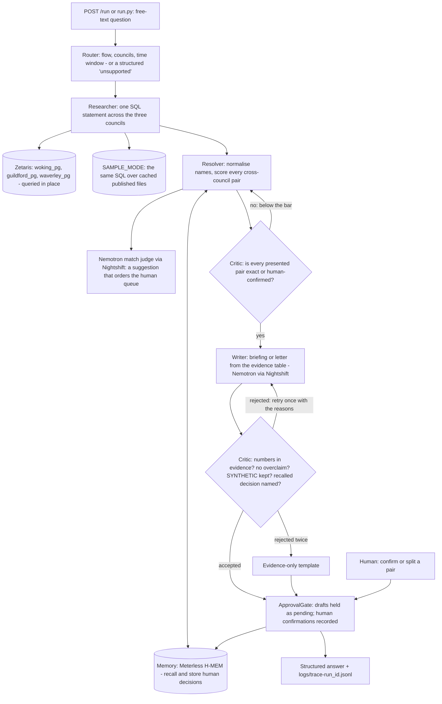

# VESTING DAY

> **Track:** Solving Fragmented Intelligence (Open Agent Hackathon 2026, Track 1). Solo entry.
> **Sponsor technology:** Zetaris (data layer), Meterless H-MEM engine (memory), Meterless Nightshift (primary AI provider), NVIDIA Nemotron.
> **Run:** `uv sync` then `uv run python run.py`, then `POST /run` on port 8000. No credentials needed.

An agent for England's merging councils. On 1 April 2027 Woking, Guildford and Waverley
(with the rest of West Surrey) become one new unitary authority. Their data does not: each
council publishes its spend on its own cadence and schema, keeps its own contracts register,
and runs its own Council Tax Support scheme. VESTING DAY queries that fragmented data in
place, resolves which suppliers the councils share, remembers every human decision so later
answers change, finds the contracts that fall off a cliff around vesting day and the policy
gaps residents hit on day one, and drafts the first actions - under a human approval gate.

**Who it is for:** the finance lead of the West Surrey shadow authority, now, before vesting
day. The migration of every system into one takes years; the merger's questions cannot wait.

**Why this track:** the three councils are three separately published, separately shaped
sources with different cadences. Zetaris federates them in place - one SQL statement across
three databases that are never merged - and every number in an answer names the council,
file and row it came from.

## What it does (real data, real numbers)

| Ask it | It answers with |
|---|---|
| Which suppliers do Woking, Guildford and Waverley share? | 228 supplier pairs shared (identical names after normalisation) across the councils' newest published windows, GBP 34.8m combined; 217 similar-name pairs awaiting a human decision. The match judge model only orders that queue; it never confirms a pair. Every row carries a provenance id |
| Confirm that 'A' (Waverley) is the same supplier as 'B' (Guildford) | A human decision stored in Meterless H-MEM as `mem-1`. The next overlap answer is resolved "using decision mem-1" - the memory changes a later answer |
| Which contracts end within six months of vesting day? (any window: "within a year", "three months", "90 days") | 173 contracts worth GBP 22.7m with no extension date recorded past 1 April 2027 (29 more have a recorded extension; 45 of the cliff suppliers are also paid by another council). The largest, GBP 8.5m at Guildford, ends 13 days after vesting day. One novation letter drafted and held for approval |
| Where do the Council Tax Support schemes differ? | 4 of 9 clauses differ (capital limit GBP 10,000 vs 6,000; minimum award GBP 5 vs 10; backdating 6 months vs 1 month; Guildford excludes bands F-H), each citing a page of the published scheme. 4 of 8 SYNTHETIC test residents would be treated differently on day one |

Per-council spend in each newest window: Woking 9,718 payments / GBP 64,974,729.21;
Guildford 6,883 / GBP 48,624,787.75; Waverley 3,246 / GBP 28,275,155.15.

Everything above comes from the councils' own published files, downloaded 25 Oct 2026
(`data/raw/MANIFEST.md` has every URL and hash). Nothing is hardcoded: the numbers are
computed at run time from the data, and change when the data or a human decision changes.
Ask your own question - the Router reads the flow, the councils and the time window from it.

## Run it in two minutes (no credentials, no services, no network)

```bash
git clone https://github.com/NakuSurrey/vesting-day
cd vesting-day
uv sync                          # Python 3.12; https://docs.astral.sh/uv/
uv run python run.py             # serves POST /run and GET /health on 0.0.0.0:8000
```

Without uv: `python -m venv .venv`, activate it, `pip install -r requirements.txt`, then
`python run.py`. With Docker: `docker build -t vesting-day . && docker run --rm -p 8000:8000 vesting-day`
(CI builds the image and runs it with `--network none`).

With no `.env`, or with `cp .env.example .env` (it ships `SAMPLE_MODE=true`), the app runs in
SAMPLE_MODE: the same agents and the same logic over the cached published data, with a
deterministic template in place of the model (badged `sample-mode/template`). Placeholder
keys never switch on live mode. Then, in another terminal:

```bash
curl -s -X POST localhost:8000/run -H 'Content-Type: application/json' \
  -d @input_examples/01_supplier_overlap.json | python -m json.tool | head -40

curl -s -X POST localhost:8000/run -H 'Content-Type: application/json' \
  -d '{"run_id": "my-1", "input": {"query": "Which Guildford contracts end within a year of vesting day?"}}'
```

Or without the server:

```bash
uv run python run.py --input input_examples/01_supplier_overlap.json
uv run python run.py --query "Which companies are paid by all three councils?"
```

Run the examples in order to watch memory change the answer:

```bash
uv run python run.py --reset-memory --input input_examples/01_supplier_overlap.json   # Unit4 pair: awaiting a human
uv run python run.py --input input_examples/02_confirm_match.json                      # a human confirms -> mem-1
uv run python run.py --input input_examples/03_supplier_overlap_after_decision.json    # pair shared, "resolved using decision mem-1"
```

Each run writes `logs/trace-<run_id>.jsonl` - one line per agent action: who acted, what it
received and produced, which agent it handed to, the model and receipt, the retry count and
the status - and echoes the same lines to the terminal. The response follows the HackOS
contract (`run_id`, `status`, `output`, `agents`, `trace_id`, `log_file`,
`execution_time_seconds`); `--out FILE` also writes it as UTF-8. Six example inputs are in
`input_examples/` with their real outputs in `output_examples/`.

## How it works

Seven agents, each a distinct code path in `app/agents/`. It is not a chain: the Critic sends
work back, the Resolver relabels, the Writer retries with the Critic's reasons, Memory changes
what the Resolver concludes, and nothing leaves without the ApprovalGate.



- **Router** classifies free text into a flow (supplier overlap, confirm a match, contract
  cliff, policy gap, approve a draft), reads the councils and the time window ("within a
  year", "three months", "90 days"), or returns a structured `UnsupportedRequest` that lists
  what it can answer.
- **Researcher** runs SQL against the data layer. Live: Zetaris REST, query-in-place over the
  three councils' registered sources. Sample: the same SQL over SQLite loaded from the cached
  files. The agent code is identical; only the adapter differs, and a test proves live rows
  equal sample rows.
- **Resolver** normalises supplier names, scores every cross-council pair (exact 0.95;
  fuzzy >= 0.92; 0.70-0.92 is the judge band), applies the decisions Memory recalled, asks
  Companies House when a key is present, and in live mode asks Nemotron for a suggestion on
  the band. The suggestion orders the human queue; it never changes a pair's status.
- **Memory** is the Meterless H-MEM engine (`app/engines/hmem`): human decisions are stored as
  long-term memories with provenance and recalled through the engine's ranked retrieval;
  every read and write lands in its append-only ledger (`data/memory/ledger.jsonl`).
- **Critic** checks every other agent and sends failing work back: pairs below the
  confirmation bar return to the Resolver; a draft returns to the Writer with the exact
  reasons when it uses a number not in the evidence, calls a pair confirmed or verified
  without a human decision, drops the SYNTHETIC label, or fails to name a remembered human
  decision it relied on. A draft rejected twice is replaced by the evidence-only template.
- **Writer** drafts briefings and letters from the evidence table only. Live: NVIDIA Nemotron
  (`nvidia/nemotron-3.5-lightning-30b-a3b`) through Meterless Nightshift, with the signed
  compute receipt id kept. Sample: a deterministic template.
- **ApprovalGate** holds every draft as `pending` and records human confirmations. Nothing is
  ever sent; approval records intent only.

Every displayed number carries a provenance id (`council:file:row`) back to the published
file; every generated text carries its model badge; synthetic data (the eight test residents
in `data/sample/residents_synthetic.csv`) is labelled SYNTHETIC wherever it appears.

## Failure handling

| Failure | Behaviour |
|---|---|
| Zetaris unreachable or slow | Three retries, then a structured `UpstreamTimeout` error (recoverable) that says so - never a silent switch to other data |
| Zetaris returns fewer rows than it says exist | Refused as `TruncatedResult`: no answer on partial data |
| Model error or timeout | The Writer falls back to the evidence-only template, badged `template-fallback`, and the trace says why |
| Model over-claims twice | The Critic rejects both drafts; the evidence-only template ships instead |
| Question outside the supported flows | Structured `UnsupportedRequest` listing the questions it can answer |
| Malformed request body | HTTP 422 with the validation message |
| No `.env`, or placeholder keys | SAMPLE_MODE: real agent logic on the cached published files |

## Live evidence (Zetaris + Nightshift + Nemotron)

Five live runs are committed in `logs/` (`response-live-0N.json` and `trace-live-0N.jsonl`):

| Run | What it shows |
|---|---|
| live-01 supplier overlap, three councils | 2 federated Zetaris queries; 228 shared, 217 awaiting a human; the Critic rejected Nemotron's first briefing for calling pairs "confirmed shared" and the retry passed; 14 Nemotron receipts |
| live-02 a human confirms the Unit4 pair | Stored in H-MEM as `mem-1`; no model call - a person decided |
| live-03 overlap again, Guildford and Waverley | `mem-1` recalled from memory; the live Nemotron briefing says "One pair was resolved using a remembered human decision (mem-1)"; the Critic again rejected a first draft that over-claimed; 14 receipts |
| live-04 contract cliff | 173 contracts / GBP 22,671,525; the novation letter drafted by Nemotron and held as draft-1 |
| live-05 Council Tax Support gap | 4 of 9 clauses differ; 4 of 8 SYNTHETIC residents; the options note drafted by Nemotron and held as draft-2 |

## Live mode (Zetaris + Nightshift)

Copy `.env.example` to `.env`, fill in the keys and set `SAMPLE_MODE=false`:

- `ZETARIS_REST_URL`, `ZETARIS_ORG_ID`, `ZETARIS_API_KEY` - a Zetaris instance with the three
  councils registered as three separate sources. Each council is its own Postgres database,
  standing in for that council's own system: loaded from its published files, never merged,
  read through a read-only login, and with no port open to the internet
  (`scripts/zetaris/` has the load script and the Lightning SQL; `docs/ZETARIS_SETUP.md` is
  the runbook). We run Zetaris on a 16 GB server and reach it over an SSH tunnel so the URL
  stays `localhost:8888`.
- `METERLESS_BASE_URL`, `METERLESS_RUNTIME_TOKEN` - from Nightshift's Console on the machine
  running it. The NVIDIA API key is set inside Nightshift's Providers, never in this app.
- `METERLESS_MODEL` - we pin `nvidia/nemotron-3.5-lightning-30b-a3b` so the NVIDIA model is
  named on every request.

`docs/LIVE_RUN.md` has the exact commands used for the committed live runs.

## Tests

```bash
uv sync --all-groups
uv run pytest -q          # 83 tests
```

- `tests/test_hmem_conformance.py` - the official H-MEM conformance suite, ported to pytest,
  run against the unmodified upstream vectors: **13/13**.
- `tests/test_hmem_golden.py` - our Python engine reproduces the TypeScript reference
  bit-for-bit (embeddings, ranking, scores, conflict resolution).
- `tests/test_run_sample_mode.py` - the run interface, real handoffs and a Critic bounce in the
  trace, provenance on every number, the memory loop changing a later answer, the approval
  gate, the structured error for unsupported requests.
- `tests/test_datalayer_zetaris.py` - a fake Zetaris in the real REST answer shape: every
  Researcher query returns the same rows as SAMPLE_MODE; a partial answer is refused.
- `tests/test_live_judge_hints.py` - live mode with a fake model: the judge's opinion never
  moves a pair, over-claims and dropped SYNTHETIC labels are bounced, a recalled decision
  must be named, and a model that keeps failing is replaced by the template.
- `tests/test_router_window.py` - judges' own phrasings route to the right flow and the time
  window comes from their words.
- `tests/test_config_sample_fallback.py` - a copied `.env.example` runs in SAMPLE_MODE.

CI (`.github/workflows/ci.yml`) runs all of them, a secrets scan, a fresh-clone run, the
judges' self-test (copy `.env.example`, ask questions that are not in the examples), and the
Docker image with no network.

## Data

`data/raw/` holds the files exactly as published; `scripts/build_sample_data.py` maps the
three schemas to one (`data/sample/spend.csv`, `contracts.csv`) and
`scripts/build_policy_clauses.py` builds the clause table with page citations, verifying each
quote against the PDF.

Why the windows differ: Woking publishes monthly and its newest file is April 2026;
Guildford publishes financial-year quarters and is at Jul-Sep 2026; Waverley publishes
half-yearly by accounting period and is at Apr-Sep 2026. There is no single month all three
have published beyond April 2026, so we take each council's newest six months and badge
every answer with its window. That mismatch is the fragmentation the project exists to
federate.

Data handling: rows whose payee looks like a natural person are dropped by the build script
(395 rows), and council card-holder names are never copied. Published under each council's
open data terms.

## Limitations, stated plainly

- Only the Lightning Nemotron lane is used. The Super-class endpoints were retired, excluded
  or end-of-life for this account during the event, so Lightning does both matching
  suggestions and drafting. The match judge reviews at most 12 pairs per run.
- Supplier identity below the exact / Companies-House bar is never asserted; those pairs are
  queued for a human. The fuzzy heuristics are deliberately conservative.
- "No extension date recorded" means the register leaves that field blank; an unrecorded
  extension option may still exist.
- The policy flow covers Woking and Guildford; Waverley's scheme is not yet in the clause table.
- The Router answers the supported question types; anything else gets a structured error.
  Months are counted as 30 days.
- Drafts are held, never sent. Approval records intent only.

## Sponsor technology

`docs/SPONSOR_TECHNOLOGY.md` explains exactly how Zetaris, the Meterless H-MEM engine,
Meterless Nightshift and NVIDIA Nemotron are used, the test for each, how the project was
built, and what was unique about our use of them.

## Development tools and AI use

Built with Claude Code, an AI coding tool the event allows (Cursor was made optional on
22 Oct 2026; Cursor was not used). Every change was reviewed, tested and committed by the
author.

## Pre-existing components

None. The first commit is 24 Oct 2026; all code in this repository was written during the
build window (22-27 Oct 2026). Third party: `third_party/hmem/vectors.json` is the Meterless
H-MEM conformance suite, copied unmodified (Apache-2.0, see `third_party/hmem/NOTICE`);
`app/engines/hmem` is our own port of the Meterless TypeScript reference. The council data
is the councils' own published open data. Licence: Apache-2.0.
